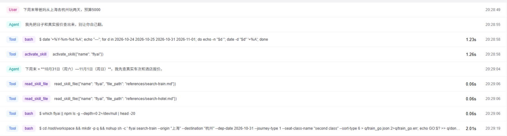
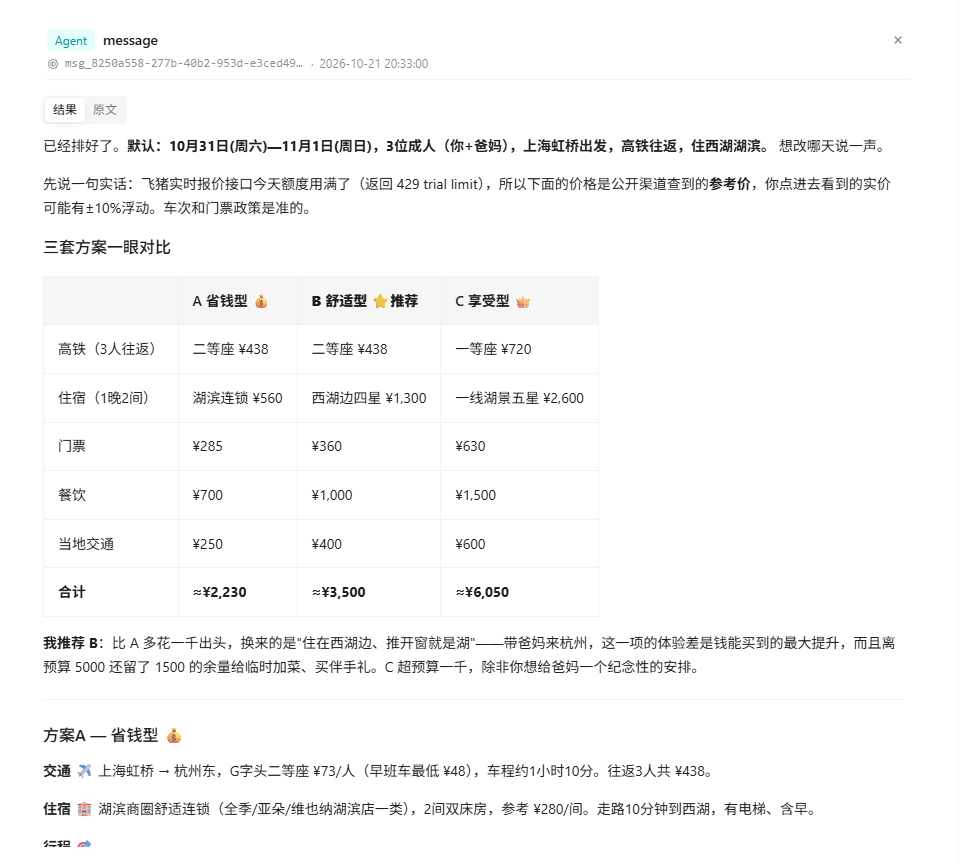
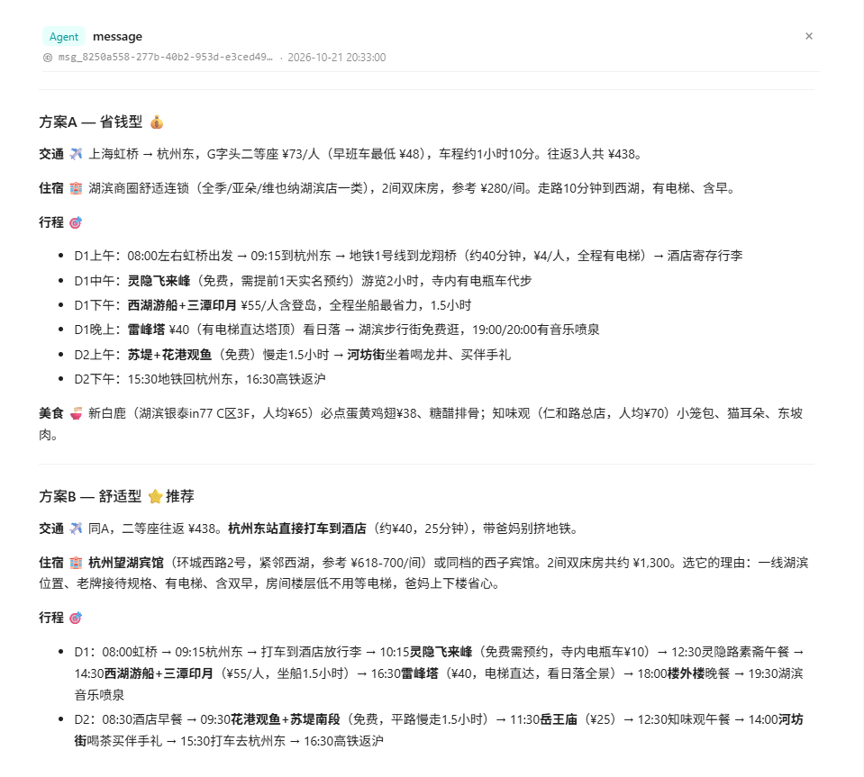
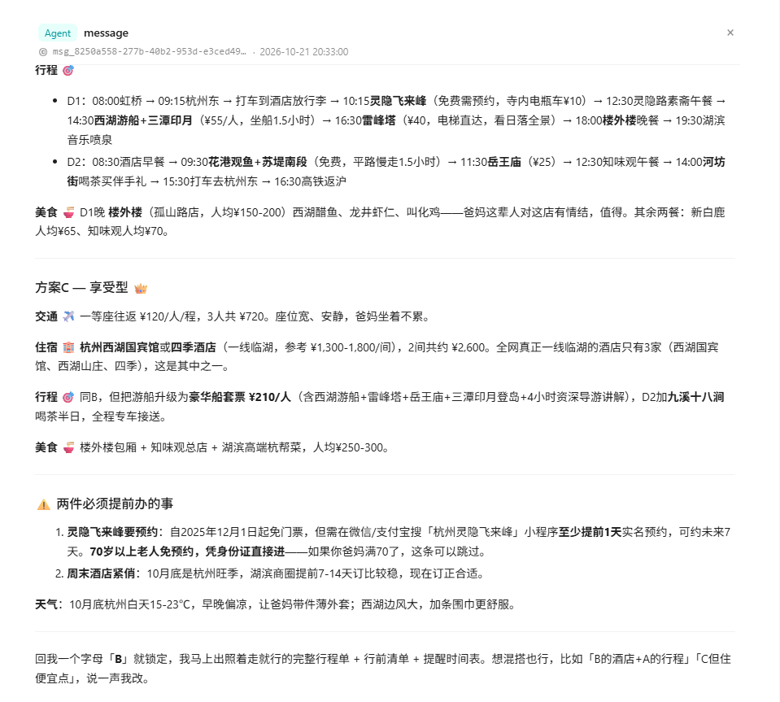
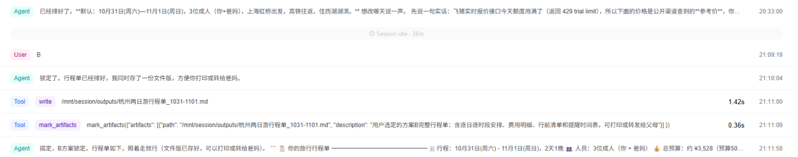
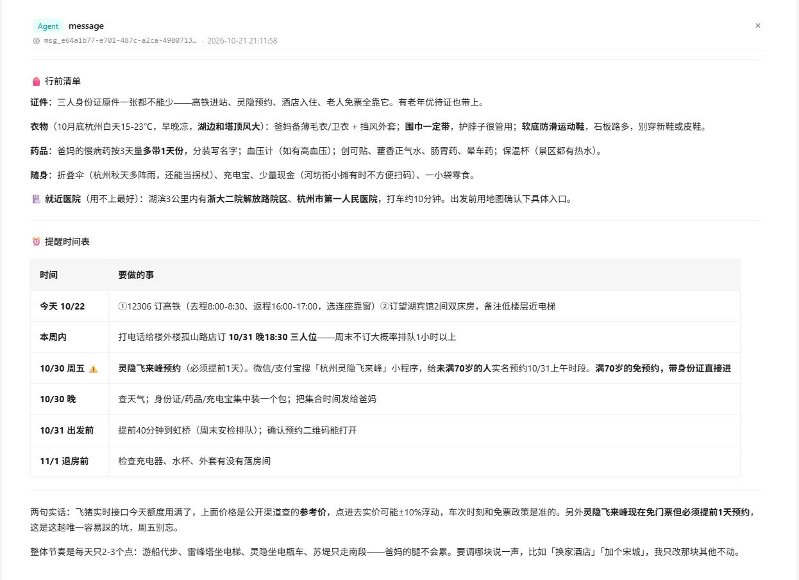

# 懒人旅行管家

> 专为懒人设计：说一句「带爸妈去杭州玩两天」，AI 管家直接给出 3 套拎包就走的方案。机票、高铁、酒店、行程、美食、行前清单全部安排好。不用做攻略，不用比价，不用回答一堆问题，回一个字母就出发。

**2026 飞猪 AI 旅行创新大赛参赛作品** · 阿里云百炼 Managed Agent + 飞猪旅行 Skill

---

## 为什么做这个

做攻略是出门前最累的一步：查车次、比酒店、排路线、找吃的，还要照顾一家老小的体力和口味。很多人不是不想出去玩，是懒得做攻略。

市面上的 AI 攻略工具大多只给一篇攻略文章，用户看完还得自己去订、自己去排。**懒人旅行管家要做的不是写攻略，是把事办了。**

## 懒人宣言

所有设计都服从这一条：**用户只负责说一句话，剩下的全是管家的事。**

| 用户懒得…… | 管家怎么做 |
|---|---|
| 打字 | 一句话就出方案。「五一带爸妈去杭州，预算5000」就是完整需求 |
| 回答问题 | 能猜就不问。缺的信息用合理默认值补上，在开头用一行写明假设，想改再说。最多只追问 1 次 |
| 做选择 | 3 套方案里直接标出推荐的那套，并说明理由。回一个「B」就算选好 |
| 看长文 | 先给一张对比表，结论在前，细节在后 |
| 自己操作 | 酒店、车次通过飞猪旅行 Skill 查询并给出预订链接，行前清单、提醒时间表一并列好 |

## 效果演示

**用户只说了一句：**

> 下周末带爸妈从上海去杭州玩两天，预算5000

以下截图来自阿里云百炼控制台里的真实会话。

**管家没有追问，先算出「下周末」的日期，再激活飞猪旅行 Skill 查高铁和酒店：**



**一次回复给出全部内容：默认假设、三套方案对比表、推荐理由：**







**这次回复里的懒人设计：**

- 默认假设一行写清：日期、人数、出发站、住哪
- 三套方案对比表（省钱 / 舒适 / 享受），标出推荐并说明理由
- 每套方案都有交通、住宿、按天行程、美食、费用汇总
- 照顾到父母：酒店有电梯、低楼层，灵隐坐电瓶车，西湖坐船，苏堤走平路
- 主动提醒：灵隐要提前预约、70 岁以上免预约、周末酒店要早订、早晚温差带外套
- 结尾一句「回我一个字母『B』就锁定」

**用户再回一个字母「B」，管家直接锁定，存一份文件版行程单，并输出行前清单和提醒时间表：**





完整对话见：
- [examples/01-带爸妈上海去杭州两天.md](examples/01-带爸妈上海去杭州两天.md)：一句话 → 3 套方案
- [examples/02-回B锁定-完整行程单.md](examples/02-回B锁定-完整行程单.md)：回「B」→ 逐时段行程单 + 费用明细 + 行前清单 + 提醒时间表

> 这次演示没有配置个人 FlyAI API Key，飞猪接口被公共额度限流（HTTP 429）。管家自动改用公开数据兜底，并如实标注「参考价」。配置 Key 后，酒店和车次会换成飞猪实时报价和预订链接。

## 核心设计：人群规则「先拆解，再组合」

不把用户套进「亲子游」「情侣游」这类固定模板，而是把同行的每个人按 5 个维度拆开，再叠加规则：

1. **年龄与体力**：决定节奏。比如婴幼儿每天 1-2 个点、必留午睡；70 岁以上老人尽量包车，并标注附近医院
2. **特殊需求**（优先级最高）：孕妇、轮椅、慢性病、带宠物、饮食限制、晕车恐高
3. **同行关系**：决定住宿分配和氛围。比如三代同堂安排「分头行动」时段
4. **人数规模**：决定资源配置。比如 6 人以上优先包车、提前订位
5. **出行目的**：放松、打卡、美食、研学、摄影、户外、纪念日

冲突时的原则：**特殊需求 > 体力最弱的人 > 其他人的偏好**。所以「退休老人结伴」「单亲带两个娃」「带狗自驾」这类没有单独列出的组合，也能推导出合理方案。

## 技术架构

```
用户一句话
   │
   ▼
阿里云百炼 Managed Agent（Qwen3.8-Max）
   │  System Prompt：懒人宣言 + 4 步工作流 + 5 维人群规则
   │
   ├── 飞猪旅行 Skill ──> flyai-cli ──> 飞猪 MCP
   │      高铁 / 机票 / 酒店 / 景点门票 实时搜索 + 预订链接
   │
   └── web_search：餐厅、天气等飞猪不覆盖的信息
   │
   ▼
3 套方案 → 用户回一个字母 → 拎包就走的行程单 + 行前清单 + 提醒时间表
```

| 组件 | 说明 |
|---|---|
| 智能体平台 | 阿里云百炼 Managed Agent |
| 模型 | Qwen3.8-Max |
| 旅行能力 | 飞猪旅行 Skill（百炼技能市场官方版） |
| 运行环境 | 云端托管，预装 npm 包 `@fly-ai/flyai-cli` |

## 复现步骤

1. **创建智能体**：在阿里云百炼 → Managed Agent → 通过向导创建
   - 名称：懒人旅行管家
   - 模型：Qwen3.8-Max
   - 系统提示词：复制 [prompt/system-prompt.md](prompt/system-prompt.md) 的全部内容
2. **配置环境**：托管类型选云端托管，预装包选 npm，填 `@fly-ai/flyai-cli`。详见 [config/environment.yaml](config/environment.yaml)
3. **挂载技能**：编辑智能体 → 技能 → 添加，在技能市场搜「飞猪」，添加「飞猪旅行」
4. **创建会话**：选择上面的智能体和环境，并添加环境变量：

   | 名称 | 值 |
   |---|---|
   | `FLYAI_API_KEY` | 你的 FlyAI API Key（在 [飞猪 AI 开放平台](https://flyai.open.fliggy.com/) 控制台申请） |

   不配这个变量也能跑，但会用到公共试用额度，很快会被限流（HTTP 429）。限流后管家会改用公开数据兜底，并把价格标为「参考价」。

5. **开聊**：直接说一句话，比如「下周末带爸妈从上海去杭州玩两天，预算5000」

配置汇总见 [config/agent.yaml](config/agent.yaml)。

## 目录

```
.
├── README.md
├── assets/                  # 百炼会话真实截图
├── prompt/
│   └── system-prompt.md     # 智能体系统提示词
├── config/
│   ├── agent.yaml           # 智能体配置
│   └── environment.yaml     # 运行环境配置
└── examples/                # 真实对话示例
    ├── 01-带爸妈上海去杭州两天.md
    └── 02-回B锁定-完整行程单.md
```

## 安全说明

本仓库不包含任何 API Key。FlyAI API Key 只通过会话的环境变量注入，不写进代码或配置文件。
